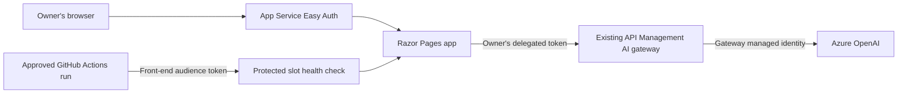

# App Service front end: identity and gated releases

Date: 2026-10-12 (Australia/Brisbane).

Status: approved by the owner in chat on 2026-10-12, after the builder check. The approval
covers this design, including its implementation choices and fixed checks. Live operations
retain their separate approval requirements. No live result is claimed here.

## 1. Purpose

Project 6 adds an App Service front end to the ReleaseLens portfolio. Its main evidence is a
signed-in person's identity reaching the existing AI gateway. A gated staging-slot release is
the supporting delivery evidence. A README table explains the service choices.

Only the owner signs in as a person. A hiring reviewer sees source, green CI, a dated report
and screenshots. The live site exists for a measured session and is destroyed afterwards.

Success means evidence that the Azure pieces work together, with the limits of the experiment
stated. A failed measurement remains a failed measurement. An identifier in a public artefact,
a weakened security setting, an unsupported claim or a stack left billing is a failure.

## 2. Decisions and boundaries

The owner agreed to:

- Lead with identity integration, followed by the gated release and architecture explanation.
- Use ASP.NET Core Razor Pages on .NET 10.
- Use one Linux Standard S1 instance in Australia East, with a four-hour session target.
- Implement the release in GitHub Actions, including the necessary workflow allowlist change.
  Staging deployment and the final swap require separate owner approval.
- Call the AI gateway directly. Answers are general model answers, without corpus retrieval
  or artefact citations. The existing API, database, Functions and AI Search are outside this
  request path and need not run for project 6.
- Use the simple mockup's question form, answer area and sign-in status, with safe failure
  messages. One question is answered at a time.
- Fix checks for identity, access protection, refresh, successful promotion, blocked promotion,
  configuration retention and teardown before a live run.

No conversation history, corpus search, citation generation, public user onboarding, performance
benchmark, availability target or UI polish project is included. The mockup is a visual
reference, not evidence that Azure authentication or deployment already works.

The following are Codex's proposed implementation choices, not additional owner decisions:
one front-end registration and one dedicated managed identity shared by this app's two slots;
a deployment identity limited to health checks at the application layer; separate manual
workflow modes for seeding, staging and promoting; and a small owner-only diagnostic endpoint.

## 3. Architecture

Easy Auth signs the owner into the bootstrap's tenant. Its login request asks for
`openid profile offline_access api://<gateway app>/access_as_user`. The server receives the
downstream access token through the platform's token headers and sends it in an individual
gateway request. Neither the browser's question form nor application HTML receives that token.

The existing gateway validates its audience and `Gateway.Invoke` role, applies limits using
the caller's `oid`, records its `Caller` dimension, and uses its own managed identity for the
model connection. The front end does not acquire an application token for model calls and
does not fall back to its managed identity when the owner's token is missing.

`src/ReleaseLens.Api/Program.cs` confirms that the existing API has API-key authentication and
an application credential for its model connection. It is not part of this design. The MCP
search tool returns passages rather than composing an answer, so it is also outside scope.

Only one human identity is tested. The report may show owner versus deployment identity as two
caller classes if the separately approved control call is run. It must not call that a test
with two people or a multi-user isolation demonstration.

## 4. Application and page behaviour

Add `src/ReleaseLens.Web` and a non-Docker `tests/ReleaseLens.Web.Tests` project to the solution.
Use the repository's SDK, central package management and warnings-as-errors settings. Render
the page and answer on the server. A small script may disable Ask while a form is submitting;
no JavaScript build pipeline is needed.

The page shows a question box, Ask, an answer area, Signed in and Sign out. The subtitle says
that these are general AI answers and ReleaseLens repository search is not connected. Show
neither the owner's name nor their email. The production page has no mockup state picker.

| Request | Behaviour |
|---|---|
| `GET /` | Owner's question page; other principals cannot use it. |
| `POST /ask` | Validate owner, antiforgery token, input and downstream token, then make one gateway call. Render the answer or a safe error. |
| `GET /health` | Authenticated owner or approved deployment principal only. Return health, immutable build version and the public slot label. No gateway or model call. |
| `GET /session` | Owner-only, no-store diagnostic response with Boolean token checks and token expiry time; no token or identity values. |
| `GET /signed-out` | Public sign-in landing page, with a relative Easy Auth sign-in link and no question form. |

Easy Auth requires authentication elsewhere and redirects unauthenticated traffic to its
sign-in endpoint. Exclude only the exact signed-out page and necessary static assets; do not
exclude the root, Ask, health or diagnostics. Sign out uses the platform endpoint and returns
to the signed-out page. Restrict all app-generated return URLs to local paths.

Trim the question and allow 1 to 2,000 characters. Limit the form request to 16 KiB. Send one
non-streaming chat-completion request to the gateway's configured model, with a maximum of
256 completion tokens and a 60-second timeout. Keep the gateway's existing budgets. Do not
retry a model request automatically. Cancellation stops the request where possible.

Before sending, require the owner principal and a present, parseable, unexpired gateway token
with the expected tenant, audience, delegated scope and role. Decoding claims here is a
conservative additional check, not signature validation: Easy Auth authenticates the caller
and the gateway cryptographically validates the downstream bearer token. Use a fresh
`HttpRequestMessage` for each call, not a shared default Authorization header.

| Condition | Page result |
|---|---|
| Empty or oversized question | Validation message; zero gateway requests. |
| Missing, malformed, mismatched or expired downstream token | Sign-in-again message; zero gateway requests. |
| Gateway 401 | Sign-in-again message. |
| Gateway 403 | Fixed access-or-quota refusal; no automatic retry. |
| Gateway 429 | Fixed limit message, with a validated bounded Retry-After value if present. |
| Timeout, network error, invalid success body or gateway 5xx | Fixed service-unavailable message. |

HTML-encode model text and retain useful line breaks. Do not render model HTML or raw
Markdown. Keep question and answer in the current response only, with no history database or
answer cookie. Read successful response bodies with a size cap; inspect refusal status and
headers without reading their bodies. Never echo a backend error, exception text or URL.

## 5. Identity and keyless authentication

### 5.1 Long-lived bootstrap additions

Create one single-tenant front-end Entra registration, its service principal, and one dedicated
user-assigned managed identity. Derive stable main and staging callback URLs from a new
bootstrap output for the app name using the existing bootstrap suffix. In public documentation,
use `https://<app host>/.auth/login/aad/callback` and the corresponding staging placeholder.

Use two front-end roles: `WebApp.Use` for the owner as a user, and `WebApp.Smoke` for the existing
deployment identity as an application. Require assignment. Declare the gateway's delegated
scope in the registration and add the front end to that scope's pre-authorized clients. The
owner's existing `Gateway.Invoke` assignment remains the source of gateway permission.

Configure a federated identity credential on the front-end registration that trusts its
dedicated managed identity. Set slot-sticky `OVERRIDE_USE_MI_FIC_ASSERTION_CLIENTID` to that
identity's client ID and use that setting name in the provider's registration configuration.
Microsoft documents this keyless Easy Auth pattern for workforce tenants.
[Microsoft's identity configuration](https://learn.microsoft.com/en-us/azure/app-service/configure-authentication-provider-aad#use-a-managed-identity-instead-of-a-secret)

Create these resources directly in Terraform without first creating a password or certificate.
Do not use the portal's automatic registration path, which creates a secret. The identity is
assigned only to the main app and its staging slot, never another workload. It receives no
gateway invocation role or model role. The shared registration has both callback URLs.

### 5.2 Platform boundary and deployment caller

Both slots use the same tenant-specific issuer and front-end audience. The platform principal
allowlist contains only the owner and deployment principal. In application code, the deployment
principal can access only health; it cannot render the question page, inspect session details
or submit a question. Require its expected object ID and smoke role. Require the owner's
expected object ID and user role for the owner routes. The IDs are configuration, never output.

Trust injected principal headers only behind the enforced App Service authentication boundary.
There is no production header-based development bypass. A test host can construct a principal
for offline tests. An unauthenticated caller supplying invented platform headers must still
be refused by the real platform.

The release job uses the existing GitHub-to-deployment-identity federation. It obtains a token
for the front-end audience for the slot probe. That token is separate from the owner's
downstream gateway token. It does not use a publish profile, stored password or Azure key.

The owner-applied webapp stack grants the existing deployment identity Website Contributor
at the web app resource, including its slot children. This permits deployment and swapping,
not role assignment creation or access to the protected bootstrap identities. The role is
session-owned and is removed during teardown. Bootstrap directory changes and this role grant
must be listed explicitly in the relevant apply approval.

### 5.3 Token store and refresh

Enable the platform token store. The scope includes `offline_access`. Use the platform's
`/.auth/refresh` endpoint for the measured refresh check, followed by a new server request.
Keep refresh tokens and cookies out of application output and logging.
[Microsoft's token guidance](https://learn.microsoft.com/en-us/azure/app-service/configure-authentication-oauth-tokens)

The documentation's token article still describes access tokens in terms of a client secret.
Whether the managed-identity assertion supplies the required downstream and refresh tokens in
this exact configuration remains a live unknown. The documentation is a reason to try the
keyless path, not proof it works here. If it fails, report the failure and revisit the design;
creating a secret or switching to an implicit grant is not an allowed workaround.

## 6. Per-session infrastructure and configuration

Add owner-applied `infra/webapp`, with separate remote state and `TF_DATA_DIR=$HOME/tfdata/webapp`
in WSL. Read bootstrap outputs through the existing state pattern. Create a new session-owned
resource group, one Linux S1 plan with one instance, the main web app, one staging slot, the
session deployment role assignment and the required configuration. Both slots use .NET 10,
HTTPS, current secure TLS settings, Always On and basic publishing credentials disabled.

Deploy compiled publish output in a ZIP with `WEBSITE_RUN_FROM_PACKAGE=1`; package content is
read-only. Use Entra-authorized deployment and disable server-side source builds. Successful
slot package deployment with those protections is unverified until the session.
[Microsoft's package deployment guidance](https://learn.microsoft.com/en-us/azure/app-service/deploy-run-package)

Use app settings for the gateway base URL, model, expected tenant, audience, owner and deployment
IDs, slot label and managed-identity assertion setting. Identifiers come from state into
process/configuration values, not committed `appsettings.json`, local files or command output.
Mark environment settings slot-sticky. Main's slot label is `main`; staging's is `staging`.

The two slots deliberately share authentication registration and identity. Keep the same
provider configuration on both; record its per-slot equality against the intended baseline
before and after a swap. This demonstrates intended configuration retention, not isolation
between two different authentication registrations.

Do not override the platform's default sticky-setting behaviour. The deployment/version stamp
belongs to the package and must move with it; it is not a sticky app setting. Terraform must
not reset release-owned package selection during an infrastructure refresh. A runtime update
that would restart a slot or invalidate evidence needs its own approved deployment step.

A regular staging-to-main swap is used. Easy Auth rules out swap-with-preview, and Linux does
not use platform auto swap. Do not turn authentication off to get those features.
[Microsoft's swap limitations](https://learn.microsoft.com/en-us/azure/app-service/deploy-staging-slots#swap-with-preview-multiple-phase-swap)

## 7. GitHub Actions release and approval boundaries

Add exactly one Azure-enabled workflow, proposed name `webapp-release.yml`. The owner approved
this allowlist expansion during brainstorming. Update `scripts/check_workflows.py` and its
tests to enforce this workflow's manual-only trigger, literal `main` guards, exact permissions,
the existing `releaselens-azure` concurrency group, cancellation disabled and SHA-pinned actions.
Keep the current `azure` environment trust and its branch restrictions. Do not create another
GitHub federated credential or grant bootstrap access.

The repository differs slightly from the handover's wording: the workflow checker and bootstrap
comments state that the GitHub environment's branch rule binds the existing environment trust
to `main`. Do not claim that the federation subject alone enforces the branch. Preserve both
the environment rule and explicit guards in the new workflow.

Use three manual modes in this one workflow:

| Mode | Authorized action and gate |
|---|---|
| `seed` | Owner approves the initial main-slot package deployment. Establish the baseline version and probe it. No swap. |
| `stage` | Owner approves one staging package deployment. Probe staging and retain a sanitized success receipt only when all checks pass. No swap. |
| `promote` | Owner separately approves one swap, bound to a successful staging run and package. Recheck staging and main immediately before swapping, then verify both slots. No package deployment. |

Each live mode is a separate dispatch. Build and test jobs have no Azure token permission.
Only the protected deployment job gets `id-token: write` and `contents: read`. A preflight job
may have narrowly scoped `actions: read` to validate the source run and CI evidence. Use the
existing checker pattern rather than broader workflow-wide permissions.

The workflow may build only reviewed source on `main`, with successful required CI for that
commit. Package receipts contain the source commit, run reference, immutable build version,
package SHA-256 and check verdicts, never hosts or Azure identity/configuration values. Public
Git commit and artifact digests identify source/builds and are permissible evidence, not Azure
tenant or resource identifiers.

Seed and candidate may use the same reviewed source with distinct immutable release stamps
for a controlled swap demonstration. Report that fact. Do not claim a functional code change
when only the stamp changed. A deliberately unhealthy fixture is a separate test package built
from reviewed source, with a running health route returning 503, and no model calls. The builder
may choose its minimal implementation; it must not add a runtime failure switch to the normal
application. A fixture package is never eligible for promotion.

Promotion preflight verifies that the staging run is this repository's approved workflow on
`main`, that its CI and stage jobs succeeded, and that its receipt matches the approved package
and current staged version. It refuses an arbitrary artifact, stale or missing receipt, changed
candidate, fixture package, mismatched version, or failed check. Re-probe staging after approval
and while holding the shared concurrency lock. The expected current main version must match
too. Any failed condition blocks the swap.

Authenticated smoke rules: HTTP 200, no redirect followed, `status=ok`, expected immutable
version, expected slot label, valid application configuration, and the expected platform
principal accepted. Health never invokes a model. Retry readiness at most 30 times over five
minutes with a 10-second per-request timeout; each invalid identity or unexpected version is
an immediate refusal, not something retries can turn into success.

After a swap, main must return the candidate version with `main`, and staging the baseline
version with `staging`. Compare security and environment settings in memory against their
per-slot baselines. A post-swap failure makes the release failed. Do not automatically swap
back: a rollback is another owner-approved swap. Capture the failed result before any repair.

The environment is an authorization gate, not a substitute for the owner's action-specific
approval. State the action, expected duration/cost and version when requesting each dispatch.
Live Azure registration changes, applies, deploys, paid calls, swaps and destroys retain their
individual approval boundaries. This design approval grants none of those live actions.

## 8. Fixed checks and evidence

Implement a Python harness under `eval/app/webapp`, following the Functions harness's separate
result files, clean-tree requirement and guarded report writer. Tests are offline; measured
commands require a clean tracked and untracked tree. The existing untracked handover must be
resolved with the owner before measurement, without deleting or silently committing it.

Each result records its check ID, verdict (`pass`, `fail` or `not run`), date, source commit,
evidence type, numeric/status observations and expected-match Booleans. Free-form error text,
raw headers, cookie values, token claims, hosts and resource names are not result fields.
Report missing results as not run. The overall result includes every mandatory subcheck.

| Check | Fixed pass rule | Evidence |
|---|---|---|
| W1: owner identity | One owner sign-in produces a present, unexpired token whose expected tenant, audience, subject, scope and role match in memory; one fixed question returns HTTP 200 with a nonempty model answer; gateway Caller telemetry for the controlled window matches the owner. All three conditions are mandatory. | Owner-only session diagnostics, sanitized answer screenshot, response status and sanitized telemetry comparison. |
| W2: access protection | Anonymous main and staging health/page/Ask probes, including invented principal headers, cannot reach the protected application routes. Accept only 401 or a 302 to that slot's configured Easy Auth sign-in route, without following it. The deployment principal gets 200 only at health and 403 at owner routes. Offline token-edge tests assert exactly zero outbound gateway calls for each missing, malformed, expired or mismatched token, and invalid/absent antiforgery or invalid input. | Live status comparisons plus separately labelled offline application tests. Missing/expired token injection into the real Easy Auth boundary is not claimed as a live test. |
| W3: refresh | Capture initial token expiry in memory, keep the authenticated session, invoke platform refresh once the initial access-token lifetime has elapsed, and obtain a new token with later expiry and the same expected owner/audience. Then one fixed question succeeds through the gateway. A successful refresh HTTP status alone is insufficient. | Owner-session client and diagnostics; expiry comparison, token-changed Boolean, one successful model-call status, owner match. |
| W4: successful promotion | Baseline is healthy; candidate staging meets every smoke condition; separate promotion approval is recorded; the workflow swap succeeds; main then serves the approved candidate and staging the baseline, with their original slot labels. No health probe calls a model. | Sanitized workflow receipts and pre/post health observations. |
| W5: blocked promotion | Deploy the reviewed unhealthy fixture to staging with its own approval. Its health check returns 503 and the stage run fails. A promotion attempt referencing that failed run is rejected; no swap step runs; main still serves the healthy baseline/current version. | Failed stage run, rejected promotion result and main version comparison. This is an expected failed release and a passed gate check. |
| W6a: settings | Before and after W4, each slot's selected sticky environment values, managed-identity attachment and authentication/security configuration equal its intended baseline. Fresh owner sign-in still works on main and staging. | In-memory comparisons saved as Booleans, slot labels and fresh sign-in observations. Same-registration limitation is stated. |
| W6b: teardown | Owner-approved destruction removes all project-6 session webapp resources and the gateway group; any soft-deleted API Management instance is purged with approval. Read-only checks verify both groups, the plan/site/slot and the deleted-instance entry are absent. Bootstrap resources remain intact. | Sanitized resource-absence Booleans and timestamps. |

W6 passes only when both W6a and W6b pass. W2 reports offline and live parts separately; their
combined verdict must not hide which boundary was actually exercised. UI rendering and error
mapping are offline tests, not claims that every upstream failure was induced in Azure.

Use a fixed harmless question for W1 and W3: "Explain why a staging slot is useful when
releasing a web app." Grade transport, identity and a nonempty answer, not answer quality.
An optional separately approved deployment-identity gateway call can add caller comparison
evidence, but it is not required for W1 and does not change the one-person limitation.

Allow up to 15 minutes for telemetry ingestion. Query existing gateway token metrics in the
controlled session window, match caller values only in memory and publish the owner-match
Boolean and counts. Run no concurrent model measurements during that window. If no matching
metric appears by the deadline, W1 fails; a decoded token alone does not establish attribution.

The owner signs in through the browser themselves. For repeatable authenticated measurements,
they supply the Easy Auth session cookie to an ephemeral WSL process through a hidden input,
never a command-line argument, file or displayed value. The harness holds it only in memory,
uses the appropriate slot origin, obtains a fresh form and antiforgery token before each Ask,
and updates its in-memory cookie jar after refresh. Treat the cookie as a bearer credential.
Do not reuse a main cookie for staging; fresh sign-in supplies the separate staging session.

Use WSL for live HTTP measurements. Where a Windows client exists, use response-header-first
handling, never read a refusal body, and never read a 204 body. Norton can hang short responses;
a Windows timeout needs WSL reproduction before being classified as a service failure.
Readiness polling and the token-expiry wait must remain interruptible and show progress.

## 9. Security, privacy and reporting

Preserve the handover's standing rules. Before owner-run Azure commands, run the existing
account guard and stop on False. The owner performs login. For CI, verify the expected
deployment identity, subscription and tenant after the protected OIDC login, publishing only
a match Boolean. Never print `az account show`, Terraform output or identity claims.

Never read `.env`; create no Azure keys, registration passwords or certificates. Terraform
runs only in WSL with separate stack data directories. Review plans for replacement/deletion
in the locked bootstrap; lifting the lock is a separate approval, never an automatic action.
Do not change security software. Use they/them for the owner and no employer material.

Keep identifiers in the already-private platform configuration/state and process memory needed
to operate it. Introduce no new local identifier-bearing file, CLI transcript or exported log.
Capture CLI output before printing; sanitize success and error paths. GitHub log masking alone
is not the report's privacy check. Disable request/response-body and token logging. Application
messages use fixed labels and status classes, with no exception text or host. Remove process
credentials when the measurement process exits.

All harness writes use the existing guarded writer, extended to reject app and SCM hosts under
`azurewebsites.net`, emails and the exact runtime names/IDs known to the session. Keep fixture
examples as placeholders. Extend the public-document scan for the new hostname family with
explicit placeholder coverage, preserving its existing checks.

`docs/webapp-report.md` states each rule, outcome and evidence source, including offline versus
live, unrun checks, elapsed billing time and the experiment's limits. Save sanitized result
files in ignored `eval/reports/`. Keep screenshots focused on app content and scrub names,
emails, address bars, account menus and resource identifiers before publication. Review the
pixels and accompanying text; the Markdown identifier test does not inspect image pixels.

The README gets the report link and the agreed service-placement table: Functions for
event-driven ingestion/MCP; App Service for a server-rendered web front end with built-in
authentication and deployment slots; Container Apps for the existing API/worker. Explain
those choices using the repository's actual implementations.

## 10. Cost and teardown

Public Azure Retail Prices API observations on 2026-10-12, Australia East, consumption rates:

| Component | Hourly rate | Four hours | Eight hours |
|---|---:|---:|---:|
| One Linux S1 instance | US$0.12; indicative A$0.171 | US$0.48; about A$0.68 | US$0.96; about A$1.37 |
| One API Management Basic v2 unit | US$0.20548 | US$0.82192 | US$1.64384 |
| Combined hourly compute, if both exist for the full period | US$0.32548 | About US$1.30 | About US$2.60 |

These are planning estimates, not a measured bill or an all-services total. The attempted AUD
gateway query was rate-limited, so no AUD gateway rate is asserted. Azure's API treats non-USD
figures as budget references. Re-query the public rates before the live session.
[Azure Retail Prices API](https://learn.microsoft.com/en-us/rest/api/cost-management/retail-prices/azure-retail-prices)

Model tokens, telemetry ingestion, storage and any gateway usage above included allowances
are additional. Before approving model measurements, show their current model meter rates,
the planned call count and token caps. Do not create a new provisioned-throughput model.
The session uses the existing bootstrap's token-metered model deployments. Main and staging
share the single S1 instance. Creation, waiting, approval and teardown time count toward billing;
stopping the app is not the teardown condition.

The four-hour target includes a token-expiry interval for W3. A session overrun is reported
and needs an updated cost estimate before further paid work. Destroy the webapp and gateway
stacks and perform the absence checks in the same session. Bootstrap registrations and
identities remain as non-hourly prerequisites. Do not destroy the bootstrap or other projects'
resources. The existing nightly app-stack destroy does not clean this new webapp stack; the
runbook must say so prominently. Do not invent permission for unattended teardown.

If the owner stops a session, arrange their approval for immediate teardown of its billing
stacks. If approval or deletion is blocked, report exactly what remains billing and the next
required action; the project cannot be declared finished. Do not permanently delete their
files or data. API Management's platform purge is a named, separately approved action.

## 11. Offline validation and delivery

Plan 1 builds code, Terraform, fixtures, checks, report renderer, workflow and runbook without
authenticated Azure calls. Public documentation/pricing lookups are read-only design research.
Use meaningful tests at the authentication, token forwarding, antiforgery, input, response and
workflow boundaries, including refusal paths with zero outbound calls and model text encoding.
Do not install Docker or work around its absence on this machine.

Required checks before a PR:

- `dotnet build` with zero warnings.
- The current non-Docker Core, Embedding and Functions suites, plus the new Web suite. The
  existing Llm suite references Docker-dependent suites and remains a CI check, as in the
  handover. Follow any more precise suite selection established by the implementation plan.
- From `eval`, `.venv/Scripts/python.exe -m pytest -q`.
- From the root, `eval/.venv/Scripts/python.exe -m pytest tests/infra -q`.
- `scripts/check_workflows.py .github/workflows` using the repository's Python environment.
- WSL `terraform fmt -check`, `validate` and mocked `test` for each touched stack, on a clean
  copy without `terraform.tfvars`. Offline tests use mocks and no live state refresh.
- Existing CI, including all Docker-dependent suites; new projects and Terraform checks join
  the appropriate jobs. Public-doc identifier checks include this spec.

The design receives a builder review and owner approval before implementation planning. Plan 1
is reviewed before asking for a push/PR. Use the repository's git identity and small descriptive
commits; capture the identity-origin check without printing the address. Push, PR, merge and
branch deletion each retain the owner's separate approval requirement.

Plan 2 uses `docs/runbook-webapp.md`. Its steps separately approve bootstrap creation, gateway
apply, webapp apply including the deployment role, seed deployment, stage deployment, smoke
measurements, paid identity/refresh measurements, promotion, unhealthy-fixture deployment,
blocked-promotion demonstration, each stack destroy and any purge. Reorder inexpensive probes
to discover a blocking identity/deployment unknown before spending the full session on W3.

After measurement, render the report, finish teardown, fill the runbook findings table and
record approved changes in section 13. Ask separately for the evidence PR and merge. A completed
project needs green CI, merged work, W6b evidence and the README report link. Ask before adding
the log line to the owner's private tracker; no private tracker change is authorized here.

## 12. Unverified facts and bounded builder choices

These require the live session. Do not assume them into a passed result:

1. Australia East's Linux S1 App Service offers the selected .NET 10 runtime and enough
   capacity to create the plan; the package starts with basic publishing credentials off.
2. Secret-free Easy Auth works from a directly created registration, with this identity shared
   only by the parent app and its staging slot, including swap warm-up behaviour.
3. Consent/pre-authorization yields an owner token with the gateway scope and existing role.
4. That configuration actually injects the downstream token and supports provider refresh
   through the token store. The secret-oriented wording in the token docs needs real evidence.
5. The deployment identity's front-end role token reaches protected slot health, while owner
   routes still refuse it; Entra-authorized ZIP deployment works at the chosen resource scope.
6. The regular swap works with Easy Auth on both slots, preserves intended configuration and
   package/version semantics, and permits fresh owner sign-in after promotion.
7. Gateway token telemetry exposes the owner's Caller value within the fixed ingestion window.
8. The existing session HTTP, CLI sanitization and report guards cover the new hosts and errors.

An unavailable SKU, failed consent, missing token, unsupported deployment or swap is a reported
finding. Stop the affected paid check, obtain approval to tear down, and propose any material
design change before another session. Do not expand access or weaken authentication to pass.

The builder may choose exact Terraform resource/provider syntax, minimal fixture implementation,
test class names, JSON schema mechanics, small CSS details, logging implementation and sanitized
metric query mechanics within the explicit boundaries above. They may not change the auth
route, use secrets, add retrieval stacks, relax pass rules or collapse approval steps.

## 13. Changes after approval

None. Add dated entries after owner approval when new evidence requires a change, including
the original decision, new evidence, proposed change, approval and effect on fixed checks.
The draft itself may be corrected after builder review before approval; those corrections do
not represent measured Azure results.
